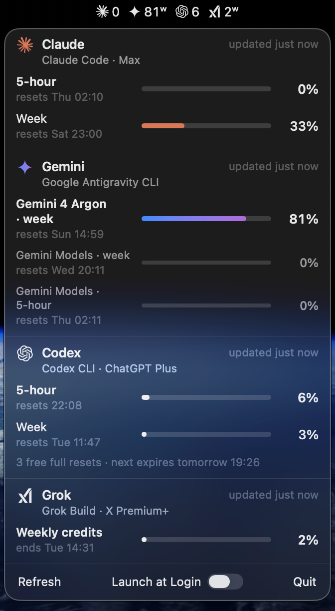

# LimitBar

**How much of your AI coding limits you've used — in the macOS menu bar.** One glance for Claude Code,
Codex, Gemini (Google Antigravity) and Grok Build; hover for the 5-hour and weekly windows and when
they reset.



- **Native and light.** A Swift menu bar app, no Electron, no background browser. It asks each CLI only
  when that CLI has been used, so an idle Mac spends ~nothing.
- **Never touches your credentials.** LimitBar asks the official CLIs you already use. It never reads,
  stores or sends a token, cookie or password — sign-in stays inside each CLI.
- **Only what you have.** CLIs you don't have installed stay out of the menu bar.

## Install

Paste this into your AI agent (Claude Code, Codex, Gemini, Grok…):

> Install LimitBar by following https://github.com/dancik/limitbar/blob/main/INSTALL.md

Or run it yourself in Terminal:

```bash
d="$(mktemp -d)" && curl -fsSLo "$d/install.sh" https://raw.githubusercontent.com/dancik/limitbar/f9d9eca2e3a6857e973ef3dedad9b797c2dd402f/install.sh && bash "$d/install.sh"
```

The link is pinned to one commit, so the script you run is exactly the one you can read
[here](https://github.com/dancik/limitbar/blob/f9d9eca2e3a6857e973ef3dedad9b797c2dd402f/install.sh). It downloads the release
build, checks its SHA-256 against the digest written into that script, checks GitHub's build provenance
when the [GitHub CLI](https://cli.github.com) is installed and signed in, and copies `LimitBar.app` to
`~/Applications`. No `sudo`, nothing outside `~/Applications` and `~/Library/Caches/limitbar`.

Prefer to compile it yourself? `bash "$d/install.sh" --from-source` builds the same pinned
commit on your Mac (needs Command Line Tools: `xcode-select --install`).

Requirements: macOS 14 or later, Apple silicon or Intel, and at least one of the CLIs below signed in.

## Sign in to the CLIs you use

LimitBar shows whatever is installed in the standard places (`~/.local/bin`, `/opt/homebrew/bin`,
`/usr/local/bin`, `~/.grok/bin`, `~/.npm-global/bin`, `~/.bun/bin`, `~/.volta/bin`). Sign in with
the CLI itself — once:

| Service | CLI | Sign in | What the menu bar shows |
|---|---|---|---|
| Claude (Pro / Max) | [Claude Code](https://docs.anthropic.com/en/docs/claude-code) `claude` | run `claude`, then `/login` | 5-hour window |
| Codex (ChatGPT plans) | [Codex CLI](https://github.com/openai/codex) `codex` | `codex login` | 5-hour window |
| Gemini | [Google Antigravity CLI](https://antigravity.google) `agy` | run `agy` once | the most-used Gemini quota (often weekly) |
| Grok | [Grok Build](https://x.ai) `grok` | `grok login` | weekly credits |

Installed somewhere else? Point LimitBar at it:
`defaults write io.github.dancik.limitbar codexPath /full/path/to/codex` (same for `claudePath`,
`agyPath`, `grokPath`), then quit and reopen LimitBar.

## Reading the menu bar

| You see | Meaning |
|---|---|
| `23` | 23 % of the window **used** (5-hour for Claude and Codex) |
| `81ʷ` | a **weekly** window — that service has no 5-hour limit, or the weekly one is what binds |
| **red** | 90 % or more used |
| `23!` | the number shown is fine, but another window of the same service (e.g. the weekly) is at 90 %+ |
| `—` | no reading yet, or the window has reset since the last reading |
| dimmed | the reading is more than 45 minutes old |

Hover (or click to pin) for every window, reset times, plan, and anything that needs attention —
"Signed out — run `codex login`", for example.

## Optional: free Claude readings from the status line

By default LimitBar runs `claude -p /usage` at most once every 20 minutes (no model call, ~3 s of CPU).
If you want live Claude numbers at no cost, let Claude Code hand them over on every reply: add this to
`~/.claude/settings.json` (it **replaces** any status line you already have):

```json
"statusLine": { "type": "command", "command": "~/Applications/LimitBar.app/Contents/MacOS/LimitBar --statusline" }
```

It prints `Claude Opus · 5h 23% · 7d 41%` in Claude Code and saves only those percentages and reset
times to `~/Library/Caches/limitbar/claude-status.json`. LimitBar never edits your settings itself.

## Security and privacy

LimitBar runs these commands, and nothing else:

| Service | Command | Notes |
|---|---|---|
| Claude | `claude auth status --json` | only `loggedIn` and the plan name are kept; the email in its answer is dropped |
| Claude | `claude -p /usage --output-format json --max-turns 1 --restricted --strict-mcp-config --no-session-persistence --settings '{"disableAllHooks":true}'` | no model call; your hooks, MCP servers and settings files are not loaded; no transcript saved |
| Codex | reads `rate_limits` lines from `~/.codex/sessions/<today>/*.jsonl`; `codex app-server` → `account/rateLimits/read`; `codex login status` | in the sandbox below |
| Gemini | `agy -p /quota --output-format json` | no model call; in the sandbox below |
| Grok | `grok agent stdio` → `_x.ai/billing` | in the sandbox below |

**The sandbox.** `codex`, `agy` and `grok` run inside the macOS kernel sandbox profile
[`Resources/cli.sb`](Resources/cli.sb): each CLI can start no program outside its own install folder — so
no MCP server, hook or plugin you configured runs — and can read or write nothing in your home folder but
its own state folder (`~/.codex`, `~/.gemini`, `~/.grok`), nor other users' folders, mounted volumes or
shared temp. `agy` additionally needs `/usr/bin/security` and your keychain (that is where its sign-in
lives), `/tmp` (its local helper). Every CLI may still `stat` a path (Node and Go resolve paths that way) — that
reveals whether a path exists, never its contents or a folder listing. If the sandbox is unavailable,
the CLI is not run at all.

How it protects you:

- **No credentials, ever.** No token, cookie, keychain item or credential file is opened by LimitBar.
- **Minimal environment.** Each CLI gets only `HOME`, `USER`, `LOGNAME`, `TMPDIR`, `LANG` and a fixed
  `PATH` — none of your API keys, GitHub tokens or SSH agent socket.
- **Only trustworthy executables.** A CLI is run only if it and its real file are owned by you or root
  and not writable by group or others. Anything else shows as "not run" in the panel.
- **Private working directory.** CLIs run in an empty folder of LimitBar's own, never in a project.
- **Hard limits.** One CLI at a time, 20–40 s deadline, the whole process group killed afterwards.
- **What it stores.** `~/Library/Caches/limitbar/state.json` (percentages, reset times, plan names;
  folder `0700`, files `0600`). No analytics, no network requests of its own.
- **Tested.** [`tests/claude-canary.sh`](tests/claude-canary.sh) proves canary hooks and MCP servers
  fire *without* the flags above and stay silent *with* them; [`tests/sandbox.sh`](tests/sandbox.sh)
  proves the sandbox; [`tests/states.sh`](tests/states.sh) covers missing, signed-out and
  unsafe CLIs. CI runs them plus [gitleaks](https://github.com/gitleaks/gitleaks) on every push.
- **Release builds** are made by [`.github/workflows/release.yml`](.github/workflows/release.yml) on
  GitHub-hosted runners from the tagged commit, with a signed
  [build provenance attestation](https://docs.github.com/actions/security-guides/using-artifact-attestations-to-establish-provenance-for-builds).
  Check it yourself: `gh attestation verify LimitBar-1.0.2.zip --repo dancik/limitbar`.

The app is ad-hoc signed, not notarized (there is no paid Apple Developer ID behind it). Installed with
the script, macOS opens it normally; a zip downloaded **in a browser** will be blocked by Gatekeeper —
use the script or `--from-source` instead.

Found a problem? See [SECURITY.md](SECURITY.md).

## Uninstall

```bash
d="$(mktemp -d)" && curl -fsSLo "$d/install.sh" https://raw.githubusercontent.com/dancik/limitbar/f9d9eca2e3a6857e973ef3dedad9b797c2dd402f/install.sh && bash "$d/install.sh" --uninstall
```

or quit LimitBar from its panel and delete `~/Applications/LimitBar.app` and `~/Library/Caches/limitbar`.

## Build and test

```bash
scripts/build-app.sh build                  # → build/LimitBar.app (native arch)
build/LimitBar.app/Contents/MacOS/LimitBar --probe   # what every CLI returns right now, as JSON
tests/states.sh build/LimitBar.app
tests/sandbox.sh
tests/claude-canary.sh                      # needs Claude Code installed; makes no model call
```

## License

MIT. Service names and marks belong to their owners; LimitBar is not affiliated with Anthropic, Google,
OpenAI or xAI. Icon credits: [Resources/marks/README.md](Resources/marks/README.md).
